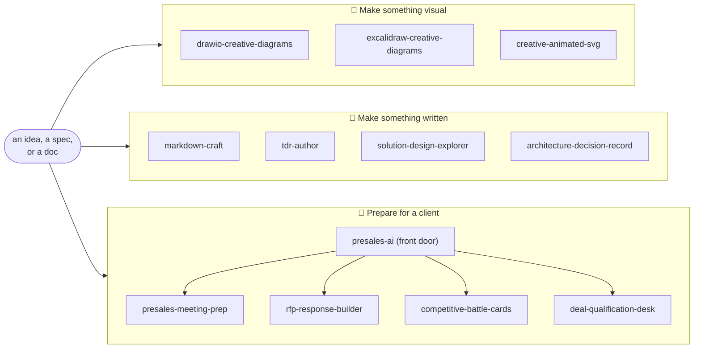
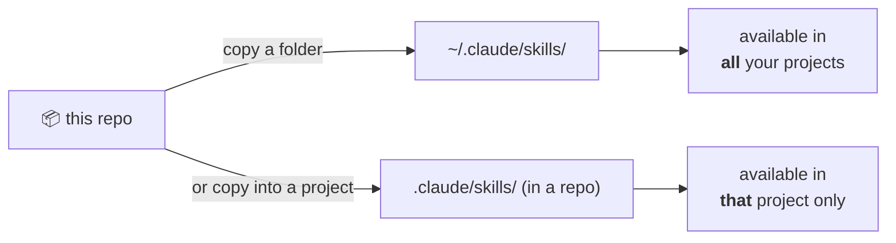
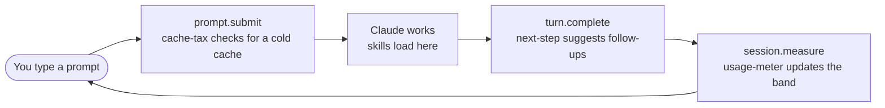

<div align="center">

# 🧰 Claude Skills

**A curated collection of [Claude Code](https://docs.claude.com/en/docs/claude-code) skills**
that turn a one-line idea — or a dense design doc — into polished, editable artifacts:
diagrams that explain themselves, SVGs that actually move, beautiful Markdown, and
review-ready design records. Plus **ten mods** that make Claude Code itself show
your usage, suggest next steps and warn before costly prompts.


[The skills](#-the-skills) · [Quick start](#-quick-start) · [Install](#-installation) · [How it works](#-how-skills-work) · [Mods](#-mods) · [Contributing](#-contributing)

</div>

---

> [!TIP]
> **New here?** Jump to [Quick start](#-quick-start) to install everything in two commands —
> then just talk to Claude Code normally. Each skill triggers itself when it's relevant.

Every skill in here follows the same philosophy: **read for the intention first, then make
the form carry the meaning** — and **verify with evidence before claiming it's done** (each
one ships its own validator script). They're not prompt snippets; they're small, opinionated
playbooks with reference docs and tooling.



## ✨ The skills

| Skill | What it gives you | Reach for it when… |
| :---- | :---------------- | :----------------- |
| 📝 **[markdown-craft](markdown-craft/SKILL.md)** | Beautiful, platform-aware Markdown — hero headers, badges, `> [!NOTE]` callouts, `<details>`, Mermaid, dark/light logos | "write a README for X", "make this doc look good on GitHub", any `.md` you want to *not* look like a wall of text |
| 🎬 **[creative-animated-svg](creative-animated-svg/SKILL.md)** | SVGs that genuinely **move** — self-drawing line art, flow-along-path, morphs, gooey/turbulence filters, loaders, hero graphics | "animate this", an SVG logo/loader/banner, a draw-on diagram, a scroll-reveal |
| 📐 **[drawio-creative-diagrams](drawio-creative-diagrams/SKILL.md)** | Polished, fully-editable **draw.io** `.drawio` files with an icon-forward look: real AWS, Azure and GCP icons at 80px and up, soft trust zones, gradient lanes, meaning-bearing edges, plus icon search, logo fetch and PNG proofing scripts | "diagram this architecture", "turn this spec into a picture", anything you'll keep editing in diagrams.net |
| ✏️ **[excalidraw-creative-diagrams](excalidraw-creative-diagrams/SKILL.md)** | Hand-drawn **Excalidraw** `.excalidraw` scenes — sketchy charm, sticky-notes, frames, switchable sketch/clean mode, draw-on animation | "sketch this", "whiteboard this idea", a wireframe, a hand-drawn figure |
| 📋 **[tdr-author](tdr-author/SKILL.md)** | Decision-first **Technical Design Records** — rationale, rejected alternatives, gap audit, Confluence-paste-safe ASCII | "write up the design for X", "document this decision", "a spec the team can review" |
| 🏛️ **[architecture-decision-record](architecture-decision-record/SKILL.md)** | An ADR in the ADP template: context, drivers, options, trade-off, outcome, consequences and risks, ready to paste into Confluence | "write an ADR", "record this decision" |
| 🚪 **[presales-ai](presales-ai/SKILL.md)** | One front door for presales. Asks what you need once, writes a shared `deal-context.json`, then routes to the four skills below or chains them into a full deal pack | "help me win this deal", "presales", "deal pack" |
| 📝 **[rfp-response-builder](rfp-response-builder/SKILL.md)** | RFP, RFI and security questionnaire answers from your answer library. Each answer is sourced and marked green, amber or red, unsourced ones go to an SME. Includes a consistency check and a proposal with a bid or no-bid box | "answer this questionnaire", "draft the proposal" |
| ⚔️ **[competitive-battle-cards](competitive-battle-cards/SKILL.md)** | Sourced one-page battle cards from internal notes and public research, plus win-loss analysis that finds leading signals in closed deals | "battle card for X", "why do we lose" |
| 🎯 **[deal-qualification-desk](deal-qualification-desk/SKILL.md)** | Market research, personas, lead lists, MEDDPICC-style scoring, two-lane SE routing and a 30-day pilot tracker | "qualify these deals", "where should SEs spend time" |
| 🤝 **[presales-meeting-prep](presales-meeting-prep/SKILL.md)** | A sourced research folder and meeting brief built in waves: identity check, company, leaders, hiring, competitors, today vs target architecture, top challenges, AI opportunities, roadmap, red team and a verification log | "prepare for a meeting with X", "research this company", "write the call script" |
| 🧭 **[solution-design-explorer](solution-design-explorer/SKILL.md)** | Deep, research-backed **solution-architecture deep-dives** — surveys how the field solves it, multi-persona reasoning, pattern comparison, self red-team, SOTA refresh, a recommendation | "architect a solution for X", "how does the industry do this?", "find the top N approaches and recommend one" |
| 💸 **[llm-finops](llm-finops/SKILL.md)** | FinOps for LLM software: cost metering from the first commit, model choice, caching and budgets, both while you build and after it ships | "add an AI feature", "build a chatbot or RAG pipeline", "why is our LLM bill so high" |

> [!NOTE]
> Each skill is self-contained: a `SKILL.md` playbook, a `references/` folder of deep-dive
> docs, and a `scripts/` validator that proves the output is correct before you ship it.

## 🚀 Quick start

Install **all thirteen** skills into your personal Claude Code skills folder, then start (or
restart) Claude Code — they load automatically.

<details open>
<summary><b>macOS / Linux</b></summary>

```bash
git clone https://github.com/vinayagrw/claude-skills.git
mkdir -p ~/.claude/skills
rsync -a --exclude mods --exclude '*-workspace' claude-skills/*/ ~/.claude/skills/
```

</details>

<details>
<summary><b>Windows (PowerShell)</b></summary>

```powershell
git clone https://github.com/vinayagrw/claude-skills.git
New-Item -ItemType Directory -Force "$HOME\.claude\skills" | Out-Null
Get-ChildItem claude-skills -Directory |
  Where-Object { $_.Name -ne 'mods' -and $_.Name -notlike '*-workspace' } |
  Copy-Item -Destination "$HOME\.claude\skills" -Recurse -Force
```

</details>

That's it. Ask Claude Code to *"diagram this"*, *"animate this SVG"*, or *"write a README for
this project"* and the matching skill kicks in. You can also invoke one explicitly by typing
`/markdown-craft` (or any skill name).

## 📦 Installation

### Where skills live

Claude Code discovers skills from two places — pick based on who should get them:



> [!NOTE]
> On Windows, `~/.claude/skills` is `%USERPROFILE%\.claude\skills`
> (e.g. `C:\Users\you\.claude\skills`).

### Install just one skill

Grab only what you want — every skill is a single self-contained folder.

<details open>
<summary><b>Simple: clone, then copy the one folder</b></summary>

```bash
git clone https://github.com/vinayagrw/claude-skills.git
cp -r claude-skills/markdown-craft ~/.claude/skills/      # swap in any skill name
```

</details>

<details>
<summary><b>Lean: sparse-checkout (download <em>only</em> that folder)</b></summary>

```bash
git clone --depth 1 --filter=blob:none --sparse https://github.com/vinayagrw/claude-skills.git
cd claude-skills
git sparse-checkout set markdown-craft
cp -r markdown-craft ~/.claude/skills/
```

</details>

### Install into a single project

Want a skill only inside one repo (and shared with your team via version control)? Copy it
into that project's `.claude/skills/` instead of your home folder:

```bash
mkdir -p .claude/skills
cp -r path/to/claude-skills/drawio-creative-diagrams .claude/skills/
```

### Update later

```bash
cd claude-skills && git pull
cp -r ./*/ ~/.claude/skills/      # re-copy the folders you use
```

## 🧭 How skills work

A **skill** is a folder Claude Code reads on demand. Each one has:

- **`SKILL.md`** — the playbook, with YAML frontmatter whose `description` tells Claude
  *when* to use the skill. That description is the trigger: Claude reads it and reaches for
  the skill on its own when your request matches — even if you never name it.
- **`references/`** — deeper docs loaded only when needed (so the base instructions stay lean).
- **`scripts/`** — runnable tooling, e.g. each skill's validator that checks the output is
  correct before Claude reports back.

Two ways a skill fires:

- 🤖 **Automatically** — Claude matches your intent against the skill descriptions. Ask to
  "make a flowchart of this" and `drawio-creative-diagrams` engages.
- ⌨️ **Explicitly** — type `/skill-name` (e.g. `/tdr-author`) to invoke it directly.

> [!TIP]
> Not sure a skill loaded? Just ask Claude *"which skills do you have available?"* — installed
> skills show up in its skill list once they're in `~/.claude/skills/`.

## 🧩 Mods

> [!TIP]
> **Skills change what Claude does. Mods change the app you work in.** This repo ships both.
> The ten mods live in [`mods/`](mods/README.md) and install as one marketplace named `my-mods`.

### Skill or mod?

| | 🧰 Skill | 🧩 Mod |
| :-- | :-- | :-- |
| **What it is** | A `SKILL.md` playbook with references and scripts | A Claude Code plugin with a hooks module (`hooks/register.tsx`) |
| **What it changes** | How Claude does a task, such as drawing a diagram | The app itself: a band above the prompt, toasts, slash commands, prompt checks |
| **When it runs** | When your request matches its description | On app events: session start, each turn, each prompt, each tool call |
| **Token cost** | Loads into context when used | Mostly none. Only next-step (smart mode) makes a small Haiku call |
| **Install** | Copy the folder into `~/.claude/skills/` | `claude plugin install <mod>@my-mods --scope user` |



### The ten mods

| Mod | In one line | Try |
| :-- | :-- | :-- |
| 📊 **[usage-meter](mods/usage-meter)** | A line above the prompt with context fill, limit windows, cost and how long the cache stays warm | `/usage-meter` |
| ➡️ **[next-step](mods/next-step)** | Three suggested next steps after each reply. A press adds the text to your prompt box | `/next-step smart` |
| 🧊 **[cache-tax](mods/cache-tax)** | Holds the first prompt after the cache goes cold and shows what it will cost | `/cache-tax on` |
| 🔍 **[context-lens](mods/context-lens)** | Bars showing what fills the context window, biggest first | `/lens` |
| 📈 **[token-insights](mods/token-insights)** | A token report for today, a week, a month or any date range | `/insights week` |
| ⛵ **[firstmate-calm](mods/firstmate-calm)** | A quieter transcript with a sailboat spinner | `/calm` |
| 🛫 **[flightdeck](mods/flightdeck)** | A live pane of context, limits, cost, cache, tool calls and subagents | `/flightdeck` |
| ✍️ **[house-style](mods/house-style)** | Your style rules in every session, em-dashes caught before they are written | `/house-style` |
| 🔁 **[loop-watch](mods/loop-watch)** | Warns when a project keeps starting sessions on its own | `/loop-watch` |
| ⏪ **[time-machine](mods/time-machine)** | Snapshots files before each edit, with a timeline, diff and restore | `/rewind` |

### Why they exist

They come from an audit of 30 of my own sessions, about 1.83B tokens, Aug to Oct 2026.

- 📦 **Big contexts.** All 104 compactions were manual, at a median of 276k tokens.
- 🚧 **Surprise limits.** The session limit was hit 37 times with no warning.
- 🧊 **Cold caches.** 67 returns after an hour idle each re-wrote about 156k tokens.
- 🔁 **Repeated follow-ups.** "What did we miss" and the truthiness check were typed again and again.

### Install the mods

```bash
claude plugin marketplace add ./mods
claude plugin install usage-meter@my-mods --scope user
```

Repeat the second line for each mod you want, then type `/reload-plugins` in Claude Code.

<details>
<summary><b>Check and test the mods before installing</b></summary>

<br/>

```bash
for m in mods/*/; do claude plugin validate "$m" && claude plugin test "$m"; done
```

Every mod ships its own test suite. See [mods/README.md](mods/README.md) for the events each
mod uses, its cost to run and the folder layout.

</details>

## 🔍 Skill details

<details>
<summary>📝 <b>markdown-craft</b> — beautiful, platform-aware Markdown</summary>

<br/>

Authors READMEs, guides, changelogs, and docs that use the full range of GitHub-Flavored
Markdown instead of flat prose. It starts by naming the **document archetype** (README vs
guide vs reference vs comparison) and laying down that shape, then leans on the right
features — centered hero, shields.io badges, alert callouts, collapsibles, Mermaid, aligned
tables, dark/light `<picture>` logos.

Its signature insight is **"know your renderer"**: GitHub, GitLab, npm/PyPI, and plain
CommonMark support different feature subsets, so the skill picks features the target can
actually render (and degrades gracefully when it can't). Ships `scripts/lint_markdown.py`,
which checks heading hierarchy, broken links/images, unresolved ToC anchors, malformed
alerts, unbalanced `<details>`/fences, and table columns. *(This very README was written with it.)*

**Try:** *"write a README for my project"* · *"format these notes into a guide"* · *"make this doc look good on GitHub"*

</details>

<details>
<summary>🎬 <b>creative-animated-svg</b> — SVGs that actually move</summary>

<br/>

Builds genuinely animated SVGs: self-drawing line art, flow-along-a-path motion, shape
morphs, gooey/turbulence filters, animated gradients, looping ambient backgrounds, charts,
glow/shimmer, loaders and hero graphics. Covers both a **standalone `.svg`** that plays the
moment it opens (CSS `@keyframes` + SMIL + filters) and **SVG-in-HTML** for the full arsenal
(scroll-driven, Web Animations API, GSAP/Lottie).

Teaches the latest CSS (`@property`, motion path, scroll-driven timelines, `color-mix`), the
**rendering-context rules** that decide whether a file actually animates (an SVG used as an
`` freezes to a static frame!), accessibility (`prefers-reduced-motion`) and 60fps
performance. Ships `scripts/validate_svg.py`.

**Try:** *"animate this logo"* · *"an SVG loading spinner"* · *"make this diagram draw itself on"*

</details>

<details>
<summary>📐 <b>drawio-creative-diagrams</b> — polished, editable draw.io</summary>

<br/>

Turns any input — a design doc, spec, API flow, or one-liner — into a `.drawio` file that a
staff engineer would happily paste into a review. Goes beyond boxes-and-arrows with
gradient-filled lanes, a semantic colour system, swimlane grouping, meaning-bearing edge
styles (control vs data vs identity paths), embedded HTML-table nodes, **animated flow
edges**, and legends. Can also embed Mermaid or generate from CSV.

Starts from the *intention* — it picks a metaphor that performs the idea (a pipeline becomes
a rail with checkpoints; a bypass is drawn physically going around the system). Ships
`scripts/validate_drawio.py`.

**Try:** *"diagram this architecture"* · *"turn this spec into a picture"* · *"visualise this API flow"*

</details>

<details>
<summary>✏️ <b>excalidraw-creative-diagrams</b> — hand-drawn whiteboard scenes</summary>

<br/>

Produces `.excalidraw` scenes with real hand-drawn charm: sketchy roughness, Excalifont
lettering, hachure fills, the curated Excalidraw palette, sticky-note clusters, titled
frames, bound labels and arrows, and freedraw highlighter accents. Switchable **sketch**
(loose brainstorm) vs **clean** (tidy deliverable) house style, plus draw-on / keyframe
animation, elbow arrows, frames-as-slides, and the Mermaid-to-Excalidraw path.

Every binding is validated so labels stick to boxes and arrows follow shapes on the first
import. Ships `scripts/validate_excalidraw.py`.

**Try:** *"sketch this on a whiteboard"* · *"wireframe this screen"* · *"make an excalidraw of this idea"*

</details>

<details>
<summary>📋 <b>tdr-author</b> — Confluence-ready design records</summary>

<br/>

Authors **Technical Design Records**: decision-first design docs that record a choice with
its rationale and rejected alternatives, grounded in the *actual* codebase (it reads the real
types/handlers before writing any contract), with an implementation **gap audit** and
concrete sub-specs for the blockers. Produces dual output — a Mermaid master that renders on
GitHub and a **Confluence-paste-safe ASCII copy** — and lints the latter for paste safety.

**Try:** *"write a TDR for choosing X over Y"* · *"document this decision for the team"* · *"turn this into a design doc"*

</details>

<details>
<summary>🧭 <b>solution-design-explorer</b> — research-backed solution-architecture deep-dives</summary>

<br/>

Produces the kind of design deliverable you'd put in front of a review board or a client:
it **surveys how the community actually solves the problem**, reasons through it with
multiple expert **personas**, proposes an architecture with Mermaid diagrams, compares the
viable **design patterns** in a matrix, **red-teams its own approach** to surface gaps, then
refreshes against the last ~2 months of state of the art before landing a clear
**recommendation** with honest scope.

It works from a fixed document skeleton and a research playbook, so the output is rigorous
rather than a vibe — and an optional pre-sales close makes the "why us" explicit when the
audience is client-facing. Ships `scripts/validate_mermaid.py` to render-check every diagram.

**Try:** *"architect a solution for X"* · *"how does the industry approach this?"* · *"find the top approaches and recommend one"*

</details>

## 🤝 Contributing

Got a skill worth sharing? PRs welcome.

1. Create a folder `your-skill-name/` with a `SKILL.md` at its root.
2. Give the frontmatter a crisp, slightly-pushy `description` — it's what makes Claude trigger
   the skill at the right time.
3. Put deep-dive docs in `references/` and any tooling in `scripts/`.
4. Include a validator and a **"verify before you claim it's done"** step — the house rule
   here is *evidence over assertion*.
5. Open a pull request describing what the skill does and when it should fire.

See any existing skill (e.g. [`markdown-craft/`](markdown-craft/SKILL.md)) as a template.

## 📝 License

Released under the [Apache License 2.0](LICENSE).

<div align="center">
<sub>Built for <a href="https://docs.claude.com/en/docs/claude-code">Claude Code</a> · skills are just folders — copy what's useful, leave the rest.</sub>
</div>
