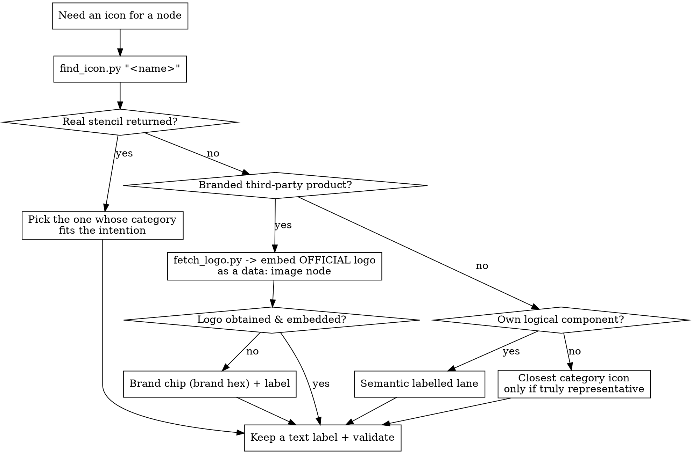

# The Icon Selection Protocol

**Never guess a stencil name.** A wrong `resIcon` (or Azure/GCP image path, or brand
logo) renders as a **blank box** in draw.io, and the validator *cannot* catch it — it's a
runtime stencil lookup, not a structural error. So for **every** icon or shape you place,
first confirm a real stencil exists for that name/title/tag; if one does, pick the best
fit for what the node *means* here; if none does, fall back deliberately. This runs
whenever you'd reach for a provider icon (`cloud-architecture-stencils.md`) or a SaaS
brand mark (`modern-diagrams-2026.md` §2).

## The six steps

1. **Name it.** Derive the canonical service/product from the node's title/label/tag — the
   thing a reader would call it ("S3", "API Gateway", "Temporal", "Firecracker microVM").
2. **Look it up.** Run the matcher against the bundled index of *real* stencil names:

   ```bash
   python scripts/find_icon.py "<name>"
   ```

   It prints the genuine `mxgraph.aws4.*` id(s) / Azure·GCP image path(s) for a real
   service — or, when nothing real matches, a fallback recommendation. (Prefer the script;
   grepping `scripts/stencil_index.json` works too.)
3. **Filter & choose by intention.** If it returns **≥1 real stencil**, pick the one whose
   *category and meaning* fit this diagram — the context disambiguates:
   - "queue" → `simple_queue_service` vs `managed_streaming_for_apache_kafka` vs `kinesis`
     by whether the edge means *task hand-off*, *event log*, or *stream*.
   - "database" → `aurora` vs `dynamodb` vs `elasticache` by durability vs cache role.
   Choose the icon that makes the node's *role* obvious, not just the first hit.
4. **Fallback ladder** — only when step 2 finds **no real stencil**. Pick the rung by
   *what the node is*, and try in this order of fidelity:
   1. **Branded third-party product** (Temporal, Firecracker, Qdrant, Deepgram, Ollama…)
      → **the official logo, fetched online and embedded as an image node.** Get the
      vendor's own mark from an **official source** — the vendor site / brand kit /
      project repo, or [Simple Icons](https://simpleicons.org) (which curates official
      brand SVGs) — and inline it as a self-contained `shape=image` node with a `data:`
      URI. The helper does the download + encode + style for you:

      ```bash
      python scripts/fetch_logo.py temporal            # verified known source
      python scripts/fetch_logo.py firecracker --label "Firecracker microVM"
      python scripts/fetch_logo.py https://cdn.simpleicons.org/qdrant/DC244C --label Qdrant
      ```

      Embed the `data:` URI (not an `http(s)` reference) so the `.drawio` stays
      self-contained — no network at render time, nothing to 404 later. Keep the text
      label below the glyph. **Provenance rule:** only embed a mark you've confirmed is
      the product's official logo; a wrong logo misleads exactly as a wrong stencil does.

      **Embedding logos in draw.io — rasterize fragile SVGs to PNG.** draw.io's built-in
      renderer is a *sanitizer, not a browser*: an SVG that renders perfectly in Chrome
      can make draw.io **log errors and mis-render**. The failure modes it can't handle —
      all present in common official marks — are: a `<svg>` with only a `viewBox` and **no
      `width`/`height`** (Simple Icons marks; draw.io can't size it), gradient/`use`
      **`xlink:href` inheritance**, **`clipPath`**, and **Inkscape/sodipodi** editor cruft
      (the Firecracker repo icon has all three). `fetch_logo.py` detects these and prints a
      `# WARNING … RASTERIZE it to PNG` banner. When you see it (or when the logo is a
      raster to begin with), **rasterize the SVG to a transparent PNG and embed the PNG
      data URI** — draw.io renders PNG data URIs with zero errors. Rasterize *and verify it
      actually shows in draw.io* (a headless-Chrome screenshot of the SVG sized to the box
      works well; view the PNG before embedding). A clean, explicitly-sized SVG needs no
      rasterizing — embed it directly.

      **Embed the data URI in draw.io's comma form, never `;base64`.** draw.io splits a
      cell's `style` on `;` and each token on the first `=`. A normal
      `image=data:image/png;base64,<b64>` therefore truncates to `image=data:image/png`
      (the `;base64` becomes an orphan token) and the logo renders as the **broken-image
      placeholder** — this bites even a perfectly valid PNG, and the validator can't see it.
      draw.io's native form drops the marker and puts the base64 straight after a comma:
      `image=data:image/png,<b64>`. `fetch_logo.py` now emits this form via
      `drawio_data_uri()`, so paste its output verbatim; if you hand-build an image node,
      use the comma form. (Verified against draw.io's own `viewer.min.js`: the `;base64`
      form shows the placeholder, the comma form renders the glyph.)
   2. **Only if no official logo can be obtained/embedded** → a **brand chip**: a rounded
      box in the brand hex + bold label (the `modern-diagrams-2026.md` §2 recipe). The
      colour+name still identifies the product; it's the graceful degradation of rung 1.
   3. **Generic role on a known platform** (a bespoke "worker" on Fargate, a "cache" on
      ElastiCache) → the closest **official-provider category icon**, *only if it's
      honestly representative*. Don't force a misleading icon just to have one.
   4. **Your own logical component** (orchestrator, adapter, agent) that isn't a branded
      product at all → a **semantic labelled lane** (the §A.0 palette).
   **Never** emit a fabricated `resIcon` as a stand-in.
5. **Always tag.** Every icon keeps a text label, so a missing or substituted glyph still
   reads. (Provider icons already label below the fill; brand chips carry the name.)
6. **Verify.** No node carries a guessed stencil name; `validate_drawio.py` is clean. A
   quick proof for a finished file — every `resIcon` used should exist in the index:

   ```bash
   python -c "import re,json;idx=json.load(open('scripts/stencil_index.json'));\
   used={m for m in re.findall(r'resIcon=mxgraph\.aws4\.([a-z0-9_]+)',open(FILE,encoding='utf-8').read())};\
   print('unknown resIcons:', sorted(used - set(idx['aws4'])))"
   ```
   An empty list = no guessed icons.

## Decision flow



## Worked rows

| Name | `find_icon.py` result | You place |
|---|---|---|
| **S3** | `mxgraph.aws4.simple_storage_service` (alias) | that AWS icon, label "S3" |
| **API Gateway** | `mxgraph.aws4.api_gateway` (exact) | that AWS icon |
| **Kinesis** | `mxgraph.aws4.kinesis` (+ streams/firehose) | the one matching the flow's meaning |
| **Temporal** | no stencil → `fetch_logo.py temporal` | **official logo** (Simple Icons SVG, brand-tinted) embedded as a `data:` image node, label "Temporal server" |
| **Firecracker** | no stencil → `fetch_logo.py firecracker` | **official icon** from the `firecracker-microvm` repo embedded as a `data:` image node, label "microVM / activity"; host on the real `ec2` icon |

`fetch_logo.py` already knows verified official sources for Temporal, Firecracker, Qdrant,
Pinecone, Deepgram, LangChain, OpenAI, Anthropic; for anything else, pass the official URL
directly. The reference diagram
`…-workspace/reference-temporal-firecracker.drawio` is the worked example — Temporal and
Firecracker render from their **embedded official logos**, every AWS service from a real
stencil, and the validator is clean with no guessed `resIcon`.

## Extending the index

If a service genuinely exists in draw.io but isn't in the index, **confirm the exact name
in draw.io's AWS/Azure/GCP shape panel first**, then add it to `scripts/stencil_index.json`
(`aws4` id → `{cat, fill, aka}`; Azure/GCP as `category/File` paths). Adding an *unverified*
name defeats the whole point — the index's value is that everything in it is real.
