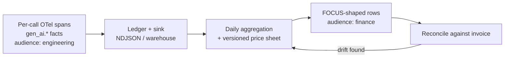
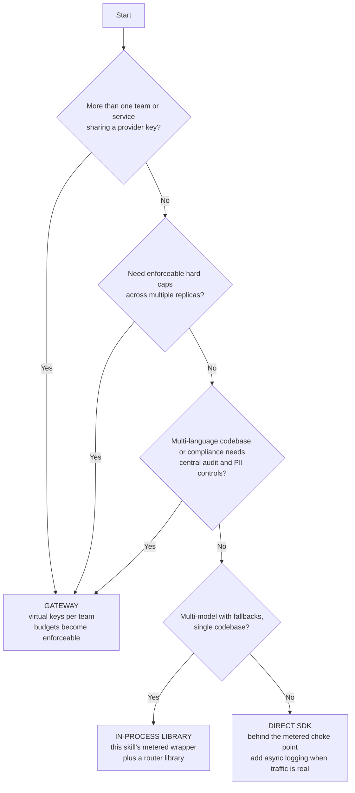

# Observability — what to emit, and who owns the price

You cannot control what you cannot attribute. This file specifies the exact per-call telemetry to
emit, why cost is *derived downstream* rather than baked into the span, how to tag for showback,
how to shape the finance rollup, and when a gateway beats a library.

Every claim carries `source` + `as_of_date` + `confidence`. No dollar figures appear here —
absolute prices live only in `references/sota-snapshot.md`.

---

## 1. Where the conventions live, and how stable they are

The OpenTelemetry GenAI semantic conventions have **moved out of the main `semantic-conventions`
repo** into a dedicated repository, `open-telemetry/semantic-conventions-genai`, covering spans,
metrics and events for GenAI clients, MCP, and provider-specific conventions. The old registry
pages on opentelemetry.io now mark every `gen_ai.*` attribute as *Deprecated (moved)*.
(source: opentelemetry.io registry + the semantic-conventions-genai repo; as_of_date: 2026-07-19;
confidence: high)

**Status: Development. No tagged release as of 2026-07-19.** Attribute names can change without a
major version bump and there is no published stabilization timeline. In practice the core
token and model attributes have settled; the fine-grained cache and reasoning attributes are the
ones most likely to move. (source: OTel blog + Greptime deep-dive; as_of_date: 2026-05-21, repo
state checked 2026-07-19; confidence: high)

Two consequences you must act on:

- Set `OTEL_SEMCONV_STABILITY_OPT_IN=gen_ai_latest_experimental` — this is the sanctioned way to
  opt into the current shape.
- **Pin and record the semconv version in your app config.** A dashboard that breaks because an
  attribute was renamed under a patch bump is a debugging session nobody budgets for.

---

## 2. Per-call span attributes

Span name: `{gen_ai.operation.name} {gen_ai.request.model}`.

| Attribute | Value | Why it earns its place |
|---|---|---|
| `gen_ai.operation.name` | `chat` \| `embeddings` \| `execute_tool` \| `invoke_agent` | chat and embeddings have wildly different unit economics; never aggregate them |
| `gen_ai.provider.name` | `gcp.gemini` \| `anthropic` \| `openai` \| `azure.ai.openai` \| `aws.bedrock` | price-table lookup key |
| `gen_ai.request.model` | what you asked for | drift detection against the served model |
| `gen_ai.response.model` | **what actually served** | the pricing key — see §3 |
| `gen_ai.usage.input_tokens` | provider-reported | |
| `gen_ai.usage.output_tokens` | provider-reported | |
| `gen_ai.usage.cache_read.input_tokens` | provider-reported | priced at a fraction of base input; must not be folded into input |
| `gen_ai.usage.cache_creation.input_tokens` | provider-reported | priced at a premium; the only evidence a cache write happened |
| `gen_ai.usage.reasoning.output_tokens` | provider-reported | billed as output; invisible in the response body |
| `gen_ai.response.finish_reasons` | provider-reported | truncation is spend with no deliverable |
| `gen_ai.conversation.id` | session or conversation id | cost-per-session, and stickiness auditing |
| `app.finops.surface` / `.stage` | custom | unit economics; a multi-call pipeline under one label hides its own worst step |
| `app.finops.tier` | `primary` \| `escalation` \| `failsafe` \| `deterministic` | escalation rate is a leading cost indicator |
| `app.finops.fallback_reason` | custom | degradation analytics |
| `app.finops.billable` | boolean | separates metered spend from subscription quota |
| `app.cost.usd` + `app.cost.price_sheet_rev` | custom | convenience denormalization, **not** ground truth — §3 |
| `app.team` / `app.feature` / `app.tenant.id` / `enduser.id` | custom | attribution — §4 |

**Content capture is OFF by default.** `gen_ai.input.messages`, `gen_ai.output.messages` and
`gen_ai.system_instructions` are opt-in in the specification, and they are simultaneously a PII
hazard, a payload-size problem, and an observability-bill multiplier — ingest-priced backends
charge you for every prompt you decide to keep. Turn them on only in a sampled debug lane with an
explicit retention decision attached. (source: OTel GenAI semconv; as_of_date: 2026-07-19;
confidence: high)

### Metrics

| Metric | Type | Dimensions |
|---|---|---|
| `gen_ai.client.token.usage` | histogram, exponential buckets 1 → 67M | token type: input / output |
| `gen_ai.client.operation.duration` | histogram, seconds | provider, model, operation |
| `app.finops.cost.usd` | counter | surface, tier, team, tenant |
| `app.finops.fallback.count` | counter | `fallback_reason` |
| `app.finops.budget.utilization` | gauge, 0–1 | window |
| `app.finops.usage_missing.count` | counter | provider, adapter |

`app.finops.usage_missing.count` above zero means an adapter is flying blind and some fraction of
your cost figures are fabricated. Alert on it. It is not a nice-to-have counter; it is the
tripwire that keeps the rest of the numbers honest.

(source for metric names and bucket guidance: OTel GenAI semconv; as_of_date: 2026-07-19;
confidence: high. The `app.*` namespace is deliberately custom — see §3.)

---

## 3. Cost is derived downstream, not baked into the span

**There is deliberately no `gen_ai.usage.cost` attribute in the conventions.** The official position
is that token counts plus model identity let you estimate per-request cost *downstream*; cost is a
derived, price-sheet-dependent value, not telemetry. The fine-grained cache and reasoning token
attributes exist precisely so a downstream cost engine can price them at their different rates.
(source: OTel GenAI observability blog + semconv registry; as_of_date: 2026-07-19; confidence: high)

The template still emits `app.cost.usd` — in a clearly custom namespace, always paired with
`app.cost.price_sheet_rev` — because a dashboard that needs a join to show a number does not get
looked at. But it is a **convenience denormalization, not ground truth**, for four reasons:

1. **Prices change, sometimes on a published future date.** A span priced at emission time can
   never be re-derived. Tokens plus served model plus timestamp can be repriced forever, including
   retroactively when you discover the sheet was wrong.
2. **Discounts are invisible at call time.** Committed-use discounts, enterprise agreements,
   credits, data-residency multipliers and batch settlement are none of them knowable in-process.
3. **The provider is the source of truth.** Derived cost must be reconciled against the invoice.
   Baking it in encourages treating the estimate as authoritative — which is how a team discovers
   a double-digit drift at quarter close.
4. **Separation of concerns.** The app emits facts: tokens, model, latency. Finance owns the price
   sheet. Couple them and a price correction requires an app deploy.

**Design rule: any figure you can recompute from raw facts, store as raw facts.** `priceSheetRev`
on every entry is what makes recomputation possible; without it you cannot tell a price change from
a usage change.

### Capture the served model, always

`gen_ai.response.model` is the pricing key. It routinely differs from what you requested:

- **Azure** requests name a *deployment*, not a model. Record the deployment separately from the
  model the response reports.
- **Bedrock** ids carry region prefixes and inference-profile ARNs. Strip the region prefix for the
  price key; keep the full ARN in the raw usage blob for forensics.
- **Aliases resolve to dated snapshots.** Requesting an undated alias and getting a dated snapshot
  is normal, and the snapshot is what is priced.
- **A free or overloaded tier may silently serve a smaller model** than the one requested.

(source: provider API references, cross-checked in R4; as_of_date: 2026-07-19; confidence: high)

Track `modelDriftRate` — the share of calls where served ≠ requested. **Nonzero drift means your
cost model describes a system you do not have.** It is also the cheapest detector for a
silently-downgraded tier, which otherwise shows up first as a quality complaint.

---

## 4. Attribution: showback before chargeback

Tag every call at the choke point, not at the call site — call sites forget. The wrapper injects
`env`, `app`, `team`, `feature`, plus request-scoped `tenantId`, `userId`, `agentId`, `sessionId`.

The four questions your tags must be able to answer:

| Question | Required dimension |
|---|---|
| Which feature is expensive? | `feature` + `surface` + `stage` |
| Which customer is expensive? | `tenantId` |
| Which team owns that spend? | `team` |
| Is a single user or agent running away? | `userId`, `agentId`, `sessionId` |

**Ship showback dashboards before you attempt chargeback.** Chargeback requires reconciled, trusted
numbers *and* an organization that has already argued about the dashboards and stopped disputing
them. Making derived estimates billable before reconciliation is the fastest way for a FinOps
program to lose credibility — once a team successfully disputes one invoice line, every subsequent
number is negotiable. (source: FinOps Foundation FinOps-for-AI guidance; as_of_date: 2026-02-17;
confidence: high)

Sequence: **emit → attribute → show → reconcile against the invoice → only then charge back.**

Two cautions on high-cardinality tags: `userId` and `sessionId` can blow up a metrics backend's
cardinality budget and your observability bill along with it. Keep them on **spans and ledger
entries** (where cardinality is cheap) and off **metric dimensions** (where it is not), aggregating
per-user cost in the rollup rather than in the metric.

---

## 5. FOCUS-shaped finance rollups

FOCUS 1.3 is the current FinOps Foundation billing specification, ratified 2025-12-05. Its
trajectory runs from cloud billing outward to SaaS, PaaS, data centre and AI spend. (source: Linux
Foundation press release + finops.org; as_of_date: 2025-12-05; confidence: high)

**What FOCUS is not: it is a billing-data schema, not a telemetry schema.** There is no
per-request or per-trace concept in it, at any version. Token-level API spend appears only if the
provider — or you — emits FOCUS-conformant billing rows. The 1.4 AI-tokenomics work is still
deciding where per-request cost belongs. Do not wait for it. (source: focus.finops.org +
FinOps-for-AI working group page; as_of_date: 2026-02-17; confidence: high)

**The two-layer architecture:**

Map into FOCUS columns at the reporting boundary, not in the app:

| FOCUS column | Value |
|---|---|
| `ServiceCategory` | `AI and Machine Learning` |
| `ServiceName` | the provider service |
| `SkuId` / `SkuPriceId` | provider + served model + token type |
| `PricingUnit` | `1M tokens` |
| `ConsumedQuantity` | tokens, split by input / output / cache-read / cache-write |
| `BilledCost` / `EffectiveCost` | from the invoice, not from your estimate |
| cost-allocation columns | your `team` / `feature` / `tenantId` tags |

Tokens fit naturally as a `PricingUnit`; FOCUS 1.2 added virtual-currency and credit-lifecycle
support, which matters if you buy prepaid token credits. (source: focus.finops.org;
as_of_date: 2026-07-19; confidence: high)

**Split the token types into separate rows.** A single blended cost-per-million hides the one thing
you most want to see: whether cache reads are displacing full-price input. That is the entire
return on the L1 work in `references/caching-and-batch.md`, and a blended row makes it invisible.

Reconciliation is the point of this layer. Run it monthly, compute drift between derived and
invoiced cost, and treat a persistent gap as a defect in the price sheet or in the adapter's usage
mapping — never as rounding.

---

## 6. Library or gateway? A staged decision tree

The community separates three concerns that get conflated: **transport** (a proxy), **decision** (a
router), and **policy** (a gateway: auth, budgets, rate limits, audit). The choice between library
and gateway is **organizational, not technical.** (source: R5, LiteLLM docs + gateway explainers;
as_of_date: 2026-07-19; confidence: high)

**Stage 1 — one team, one app, modest spend.** Call providers directly behind this skill's choke
point. No network hop, no infra. Add async logging when traffic becomes real.

**Stage 2 — one codebase, multi-model, cost-aware.** An in-process router gives you fallbacks and
cheap-model routing with no ops burden. The catch: **enforcement dies if a developer bypasses the
library**, and every language needs its own implementation. This is exactly reference gap G1 —
guard it with a lint rule or an import-scanner test.

**Stage 3 — multiple teams or services sharing spend. This is the gateway trigger.** When two teams
share a provider key, nobody can attribute or cap spend. Centralized virtual keys with per-team
budgets make budgets *enforceable* rather than merely observable — and per
`references/runtime-patterns.md` §6.3, a gateway virtual key is one of only two ways `hard-stop`
means anything across replicas. Budget hierarchies in mature proxies run proxy → org → team → user
→ key → end-customer, with configurable reset windows; exceeding a budget returns an auth-style
error until reset. (source: LiteLLM proxy docs, live; as_of_date: 2026-07-19; confidence: high)

**Stage 4 — zero infra, instant multi-model.** A managed marketplace router. Pay a platform toll on
credit purchases (and a percentage on bring-your-own-key beyond a free request allowance) for
convenience; accept weaker governance — account-level rate limits and far coarser per-key budgets
than a self-hosted proxy. It is a spend-*access* layer, not a spend-*governance* layer.
(source: OpenRouter FAQ, live; as_of_date: 2026-07-19; confidence: high)

### Price the gateway itself

A gateway is never free, and the license fee is usually the smallest line:

| Cost | What it actually is |
|---|---|
| Software | Often zero for the open-source proxy core. **Budget and rate-limit tiers are frequently enterprise-gated**, and enterprise list pricing is typically not public — third-party estimates are **unverified**. (confidence: low) |
| Infrastructure | Postgres for keys and spend, Redis for multi-instance rate limiting, HA instances. This service never shrinks. |
| Latency | A single-digit-millisecond added hop for compiled proxies; tens of milliseconds for interpreted ones. Vendor latency figures are **vendor claims, not independently verified**. (confidence: low) |
| Availability | A new single point of failure. You must take an explicit fail-open or fail-closed stance — fail-open means budgets stop enforcing exactly when things are going wrong. |
| Ops | Config in CI, key rotation, upgrade cadence, an on-call owner. |
| Observability | A managed observability tier is usually priced per ingested trace or span. Content capture (§2) multiplies this directly. |

**Do not adopt a gateway to save money on tokens. Adopt one to make budgets enforceable and spend
attributable across teams.** If you have one team and one service, the gateway costs more than it
saves, and the choke point in this skill already gives you the ledger.

**The constraint a gateway will not solve:** routing interacts badly with prompt caching. Switching
model or provider mid-session destroys the cached prefix — which is why session stickiness exists
in the routers that have it, and why this skill pins a session to its first resolved provider.
See `references/runtime-patterns.md` §7. (source: OpenRouter model-routing docs;
as_of_date: 2025-12-04, verified live 2026-07-19; confidence: high)

---

## 7. Emission checklist

- [ ] `OTEL_SEMCONV_STABILITY_OPT_IN` set, and the semconv version pinned and recorded in config.
- [ ] Served model captured separately from requested; `modelDriftRate` monitored.
- [ ] Cache-read and cache-write tokens emitted as distinct attributes, never folded into input.
- [ ] Reasoning tokens emitted; they are billed as output and are invisible in the response body.
- [ ] `app.cost.usd` always paired with `app.cost.price_sheet_rev` — never one without the other.
- [ ] Content capture off outside a sampled debug lane, with a retention decision attached.
- [ ] `app.finops.usage_missing.count` alerted on; nonzero means fabricated cost figures.
- [ ] High-cardinality ids on spans and ledger entries, not on metric dimensions.
- [ ] Daily FOCUS-shaped rollup exists, with token types split, and monthly invoice reconciliation
      scheduled.
- [ ] Showback dashboards shipped and accepted before any chargeback is proposed.
