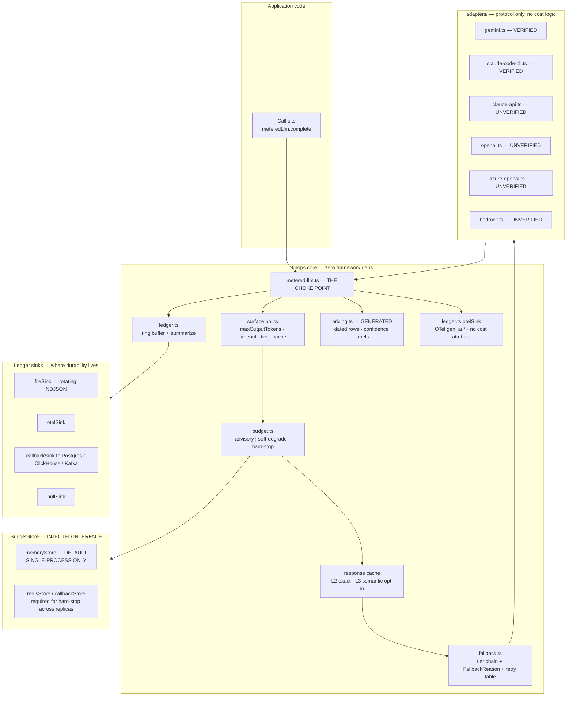
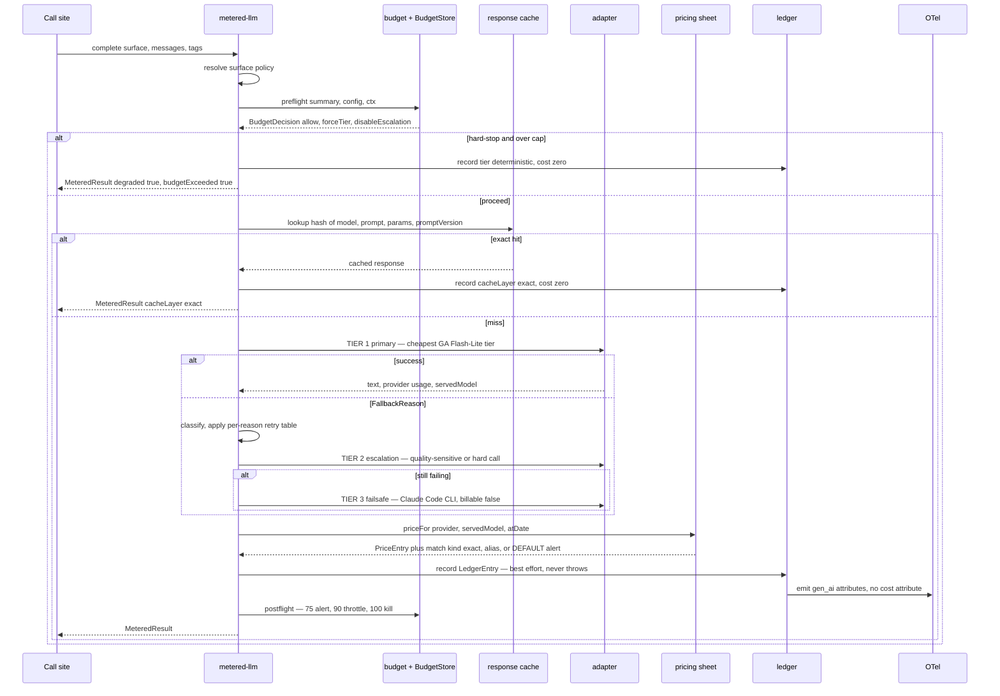

# Runtime patterns — the metering core

The shipped cost machinery: one choke point, one ledger, one budget policy, one emission path.
Read this before writing any code that calls a model in a product.

All claims below carry `source` + `as_of_date` + `confidence`. `high` = primary vendor or
specification source read directly; `medium` = corroborated secondary; `low` = single third-party
source or unverified inference. Numbers that are *dollars* live in exactly one file:
`references/sota-snapshot.md`. Nothing here quotes a price.

---

## 1. Architecture



**Layer rules, so each layer is unit-testable alone:**

- **Adapter** — protocol only. One provider, returns `NormalizedUsage` plus the *served* model.
  Knows nothing about cost, budgets, or ledgers.
- **Metered wrapper** — the only module that imports adapters, and the only place a `LedgerEntry`
  is constructed.
- **Ledger** — ring buffer for `summarize()`, pluggable sink for durability.
- **Budget policy** — pure functions over a summary plus an injected clock and an injected
  `BudgetStore`. No I/O of its own.
- **Emission** — translates a `LedgerEntry` into OTel attributes. Optional dependency; no-ops when
  OTel is absent.

Why the strict separation matters: cost bugs in this layer fail *silently* — a wrong `costUsd`, not
a crash. Silent failures are only catchable by tests, and tests only exist when the units are small.

---

## 2. Request flow



**There is no path that skips metering.** Even the zero-cost deterministic fallback writes a ledger
entry with `tier: 'deterministic'`, because *how often you degrade* is a first-class FinOps and
reliability signal. The reference project's fallback wrote nothing, which made "was that really the
model?" answerable and "how often do we degrade?" unanswerable. (source: reference-project audit,
`REFERENCE_ASSETS.md` gap G1/G5; as_of_date: 2026-07-19; confidence: high)

---

## 3. The ledger

One entry per attempt — retries and fallbacks each get their own row, joined by `requestId`.
Retries *are* spend; a ledger that hides them under-reports the true cost of a flaky provider.

| Group | Fields |
|---|---|
| identity | `id` ULID, `ts` ISO-8601 UTC, `requestId`, `traceId`, `spanId` |
| what ran | `surface`, `stage`, `provider`, `tier`, `requestedModel`, `servedModel` |
| usage | `inputTokens`, `outputTokens`, `cacheReadTokens`, `cacheWriteTokens`, `cacheWriteTtl`, `reasoningTokens`, `cacheLayer` |
| money | `costUsd`, `notionalCostUsd`, `billable`, `estimated`, `priceSheetRev`, `batch` |
| operations | `latencyMs`, `finishReason`, `ok`, `fallbackReason` |
| attribution | `tags`: env, app, team, feature, tenantId, userId, agentId, sessionId, plus arbitrary keys |

Four fields carry more weight than they look:

- **`servedModel`** is the pricing key, not `requestedModel`. Azure requests name a *deployment*;
  Bedrock ids carry region prefixes; aliases resolve to dated snapshots; a free tier may silently
  downgrade Pro to Flash under load. Pricing the requested model prices a system you do not have.
  (source: R4 + provider API references; as_of_date: 2026-07-19; confidence: high)
- **`cacheReadTokens` / `cacheWriteTokens`** are separate because they are priced differently —
  reads at a small fraction of base input, writes at a premium. Collapsing them into `inputTokens`
  destroys the only evidence that caching is working. See `references/caching-and-batch.md` §5.
- **`billable`** is not the same as `costUsd: 0`. A Claude Code CLI call under a subscription has
  near-zero marginal cost but consumes a rate-limited quota, so record
  `costUsd: 0, notionalCostUsd: <CLI-reported>, billable: false` and report both. Hiding the
  notional figure is how teams discover their subscription ceiling in production.
- **`estimated`** is set *only* when the provider returned no usage object. There is no estimation
  code path — no `chars/4`, ever. A missing usage object is a monitoring event
  (`finops.usage_missing` counter), not something to paper over with arithmetic. A nonzero
  `estimatedRate` in `summarize()` is a defect signal.

**Sink interface — durability lives here, not in the ring.**

```ts
export interface LedgerSink {
  write(entry: LedgerEntry): void | Promise<void>;  // MUST NOT throw
  flush?(): Promise<void>;
}
// shipped: fileSink(path, {maxBytes, rotate}) | otelSink() | callbackSink(fn) | nullSink()
```

`fileSink` writes rotating NDJSON — append one line. Do not rewrite a whole JSON array per call;
that is O(n) per request and becomes a latency tax exactly when traffic grows.

`summarize()` returns totals plus breakdowns by surface, stage, model, provider, tier, team and
tenant, plus derived unit economics: `costPerRequest`, `costPerSession`, `cacheHitRate`,
`fallbackRate`, `degradedRate`, `estimatedRate`, `retryCostShare`, `modelDriftRate`.

**The ledger is not an audit log.** It is a rolling operational record; the sink is what you
retain. Never build chargeback on a ring buffer — see §6 for why the same mistake is fatal in
budgets.

---

## 4. Invariant: instrumentation never breaks the response path

Metering is a side effect of answering the user. If it can fail the request, you have traded an
outage for a number, which is always a bad trade.

Implement it structurally, not by convention:

1. `record()` is **synchronous** and does exactly one thing that can't fail — push onto the ring.
2. The sink write is dispatched on a **microtask** (`queueMicrotask` / `void Promise.resolve()`),
   wrapped in `try/catch`, incrementing a `finops.sink_failures` counter on error.
3. There is **no `await`** anywhere between the adapter returning and the caller receiving the
   result. Ledger, pricing lookup and OTel emission all sit off the awaited path.
4. Every emission call is individually caught. One broken exporter must not take down metering,
   and metering must not take down the app.
5. Bound everything: ring cap, sink queue depth, emitted attribute count. An unbounded buffer is a
   memory leak wearing a monitoring costume.

**Test it, don't assert it.** Ship a test that injects an always-throwing sink and asserts the LLM
response is byte-identical to the no-sink case. Also inject a sink that returns a rejected promise
— unhandled rejections crash Node processes under default settings, so the catch must be attached
at dispatch, not later.

---

## 5. Tiering and the fallback chain

The shipped default chain, per the locked build decision:

| Tier | Route | When |
|---|---|---|
| `primary` | Gemini `gemini-3.1-flash-lite` — cheapest GA tier, implicit context caching | every call by default |
| `escalation` | Gemini `gemini-3.5-flash` | call is tagged quality-sensitive: chat, user-facing prose |
| `escalation` | Anthropic Sonnet-class, metered, explicit prompt cache | hard calls declared at the call site, or a quality gate rejected the cheaper output |
| `failsafe` | Claude Code CLI transport, subscription, near-zero marginal cost | only on a `FallbackReason` — never on quality grounds |
| `deterministic` | no model at all | budget kill, or every tier above failed |

Rules that make this chain honest:

- **No preview SKUs in any default path.** Preview pricing and preview availability both change
  without notice; a default that depends on one is a default that breaks on someone else's
  schedule. (source: locked build decision; as_of_date: 2026-07-19; confidence: high)
- **Cross-vendor is accepted deliberately.** The escalation to a Sonnet-class model is a considered
  choice, not a router's guess — see §7 on stickiness for the cache cost this incurs and why it is
  only paid on explicit escalation.
- **The failsafe is a transport, not a better model.** It is reached only via `FallbackReason`,
  gated by `probe()`, and skipped entirely if the binary or auth is absent. Nothing on the hot path
  depends on a CLI existing.
- **Every metered surface must register a zero-cost deterministic fallback.** A surface without one
  cannot be registered. This is what makes `hard-stop` survivable rather than an outage.

### FallbackReason classification

```ts
export type FallbackReason =
  // transport / auth
  | 'spawn-failed' | 'not-authenticated' | 'no-tools' | 'network-error'
  // provider signals
  | 'rate-limited' | 'quota-exhausted' | 'overloaded' | 'api-error'
  | 'context-length-exceeded' | 'content-filtered'
  // response quality
  | 'timeout' | 'empty-output' | 'malformed-output' | 'ungrounded' | 'schema-violation'
  // cost governance
  | 'budget-exceeded' | 'envelope-exceeded' | 'degrade-policy';
```

Retry versus fall-through is a **per-reason table**, not a blanket policy. A blanket retry policy
either wastes money on failures that will repeat identically, or gives up on blips that a single
retry would have fixed.

| Reason class | Behaviour | Why |
|---|---|---|
| `rate-limited`, `overloaded`, `network-error` | 2 retries, exponential backoff with full jitter, honour `Retry-After`, then next tier | transient by definition; jitter prevents your own retries from becoming the thundering herd |
| `quota-exhausted`, `not-authenticated`, `spawn-failed` | no retry; next tier, and mark the tier unavailable for a cooldown | the condition is durable; retrying makes every subsequent request pay the failure latency |
| `context-length-exceeded` | no retry; escalate to a larger-context tier if one exists, else deterministic | a blind retry pays full input tokens to fail identically |
| `empty-output`, `malformed-output`, `schema-violation` | exactly **one** repair retry at the same tier, then next tier | repair loops are a classic runaway-cost pattern; the cap is the whole control |
| `ungrounded`, `content-filtered` | no retry, no escalation, straight to deterministic | a grounding violation is a correctness failure; a pricier model reproduces the same bug at a higher rate |
| `budget-exceeded`, `envelope-exceeded`, `degrade-policy` | no retry; jump to the tier the budget decision names | the decision has already been made upstream |

---

## 6. Budget policy

### 6.1 The three modes

```ts
export interface BudgetConfig {
  mode: 'advisory' | 'soft-degrade' | 'hard-stop';   // ONE-LINE SWITCH, default 'advisory'
  monthlyUsd?: number; dailyUsd?: number;            // daily nests under monthly
  perSessionUsd?: number; perAgentUsd?: number;
  ladder: { alertPct: 75; throttlePct: 90; killPct: 100 };
  window: 'calendar-month' | 'rolling-30d';
  store: BudgetStore;                                 // INJECTED — see 6.3
}
```

| Mode | 75% | 90% | 100% |
|---|---|---|---|
| **`advisory`** (default) | alert, meter amber | alert, meter red | alert, `overBudget: true`. **Never blocks.** |
| `soft-degrade` | alert | throttle: force cheapest tier, disable escalation, halve max output, disable reasoning, prefer non-billable transport | kill paid tiers: failsafe then deterministic. App keeps working at zero cost. |
| `hard-stop` | alert | throttle, as above | refuse paid calls; deterministic only; `degraded: true, budgetExceeded: true` |

The 75/90/100 ladder is **practitioner convention, not a FinOps Foundation standard** — the
Foundation deliberately publishes no percentages. Say so when presenting it to a client. (source:
finops.org FinOps-for-AI guidance; as_of_date: 2026-02-17; confidence: high)

Advisory is the default because a false hard-stop in a demo or early build is worse than an
overrun, and because the alternatives ship and switch in one field. Move off advisory when **any**
of these holds: the app serves real customer traffic; spend is charged back per customer or tenant;
the workload runs autonomous agent loops or parallel subagents; a single tenant can drive unbounded
volume; or monthly spend has grown past the point where a month of overrun would need explaining.
Use `soft-degrade` for user-facing apps — graceful quality reduction beats an outage. Use
`hard-stop` for batch and offline jobs and per-tenant caps, where refusing is the correct answer.

`soft-degrade` is only honest if the degradation is **visible**: `MeteredResult.degraded` must
reach the UI. Silently serving worse answers to save money is a trust bug, not an optimization.

### 6.2 Per-agent envelopes are always enforced

```ts
export interface AgentEnvelope {
  agentId: string; budgetUsd: number; maxCalls: number; maxWallMs: number;
  onExceeded: 'stop-agent' | 'degrade-agent';   // default 'stop-agent'
}
```

Envelopes fire **even in `advisory` mode**. This is the one deliberate exception and it is the
right one: advisory means "don't let a budget threshold break the user's app," not "let a looping
agent spend without limit." An envelope breach kills one agent; the orchestrator collects partial
results and continues, so blast radius is one branch of a fan-out.

Sensible envelope defaults for fan-out orchestrators: concurrency at most 2, at most 2
alternatives, exactly 1 reflexion round, a wall-clock budget in the low minutes — and above all,
**compute host-side whatever code can compute.** KPI tiles, aggregations, sorts and counts get
plain functions with zero LLM calls. The cheapest token is the one you never send.

### 6.3 BudgetStore is an injected interface — read this before trusting a cap

```ts
export interface BudgetStore {
  add(key: string, usd: number, window: WindowSpec): Promise<void> | void;
  get(key: string, window: WindowSpec): Promise<number> | number;
  kind: 'memory' | 'redis' | 'callback';
}
// shipped: memoryStore()  ← DEFAULT, SINGLE-PROCESS ONLY
//          redisStore(client) | callbackStore(fns)
```

**`memoryStore()` is single-process only.** It is the default because most first builds are a
single process, and it is the wrong default the moment you deploy more than one. The failure mode
is not subtle:

- **Across N replicas, a monthly cap becomes N times that cap.** Under autoscaling it is
  effectively unbounded — the cap scales with your traffic, which is precisely backwards.
- **A calendar-month window computed over a bounded ring is arithmetically wrong past the ring
  size.** Entry 2,001 silently evicts entry 1, and the "month to date" total starts shrinking.
- **A process restart resets the counter.** Every deploy refunds the budget. A team deploying
  daily has, in effect, a daily cap they never configured.
- **The mode with the strongest safety claim is the most likely to be inert.** `hard-stop` is what
  you would reach for on a per-tenant cap or a batch job — exactly the workloads most likely to run
  multi-instance.

Therefore: **`hard-stop` enforcement requires a shared counter (`redisStore`, `callbackStore`
backed by your own store) or a gateway virtual key** with a provider-side budget. `advisory` and
`soft-degrade` on `memoryStore` are process-local *heuristics* and must be described that way to
anyone who might mistake them for controls.

**Make it visible at runtime, not at invoice time.** `health()` reports `budgetStore: 'memory'`
alongside `estimatedRate` and `modelDriftRate`. A limitation you can only learn by reading a doc is
a limitation that will be discovered from a bill.

The identical defect applies to the **L2 exact response cache**: a per-process LRU has an N-times
miss rate across replicas. Same fix — a shared store — and same visibility rule.

---

## 7. Session-sticky routing, and why blind auto-routers are rejected

```ts
export interface RoutingConfig {
  sticky: boolean;                                       // default TRUE
  stickyKey: 'sessionId' | 'tenantId' | 'conversationId';
  stickyTtlMs: number;                                   // default 15 minutes
}
```

Once a session's first call resolves to a `(provider, model)` pair, every later call in that
session pins to it until the chain fails or the TTL expires.

1. **Cache economics dominate routing economics.** A cached read costs a small fraction of base
   input. A router that saves a fraction of sticker price by switching providers mid-conversation
   destroys a prefix worth far more. The router wins on the invoice line it can see and loses on
   the one it can't. OpenRouter ships session stickiness for exactly this reason. (source:
   OpenRouter model-routing docs; as_of_date: 2025-12-04, verified live 2026-07-19; confidence: high)
2. **Mid-session provider switches change behaviour, not just price** — formatting, refusal
   boundaries, tool-call shape. Users experience it as a bug.
3. **Provider-native routers only route within one family** (Bedrock Intelligent Prompt Routing,
   Azure AI Foundry Model Router), so they cannot make the cross-vendor call that actually matters
   here. (source: R5, vendor pages; as_of_date: 2026-07-19; confidence: high)
4. **The savings claims are unaudited, and one router's own fee is contested.** Bedrock IPR's
   routing fee is reported inconsistently across sources and is **unverified** as of 2026-07-19. A
   cost lever whose own price is unknown is not a cost lever. (confidence: low — conflicting
   third-party sources, quarantined in `RESEARCH_SYNTHESIS.md`)

**The stance: routing is a deliberate, evaluated decision — never an implicit one.** Two escalation
triggers ship, both explicit:

- **Call-site declaration.** The developer tags the request quality-sensitive or hard.
- **Quality-gate escalation.** A *deterministic, zero-token* validator — schema check, citation
  allow-list, numeric-range check — rejects the cheap tier's output, and only then does one retry
  at the escalation tier. It costs nothing to evaluate and escalates on evidence rather than on a
  guess about "complexity."

Auto-routers may be adopted later, but only behind an eval harness measuring quality-per-dollar on
a fixed fixture set, and only with stickiness preserved within a session. Never enabled blind.

---

## 8. Checklist before you call this done

- [ ] No raw provider SDK call outside `metered-llm.ts` — enforce with a lint rule or an import
      scanner test, because a meter with a bypass is not a meter.
- [ ] Throwing-sink test passes: response unchanged.
- [ ] Every registered surface has a zero-cost deterministic fallback.
- [ ] `budgetMode` is stated explicitly in config — the defect is not "advisory", it is "nobody
      chose".
- [ ] `health()` reports `budgetStore`, `estimatedRate`, `modelDriftRate`.
- [ ] If `hard-stop` is set: `store.kind !== 'memory'`, or a gateway virtual key backs it.
- [ ] Per-agent envelopes configured for every fan-out orchestrator.
- [ ] `estimatedRate` is zero. If it isn't, an adapter is flying blind.
