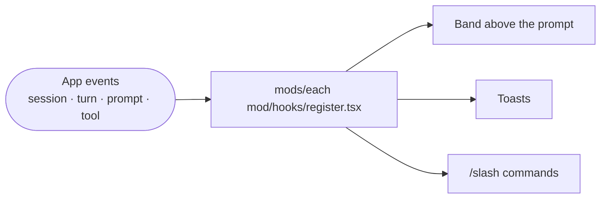

<div align="center">

# 🧩 Claude Code Mods

**Ten small plugins that change Claude Code itself:** usage at a glance, suggested next steps
after each reply, a guard against cold-cache costs, a token report, a live cost pane,
file rewind, a loop alarm and your house style in every session.


</div>

---

## What a mod is

A mod is a Claude Code plugin with a hooks module. It listens to app events such as
`turn.complete` or `prompt.submit` and can draw a band above the prompt, show a toast, add a
slash command or change a prompt before it is sent. This folder is a ready marketplace named
`my-mods`, so you can install all ten mods at once.



## The mods

| Mod | What you get | Command | Events it uses | Cost to run |
| :-- | :-- | :-- | :-- | :-- |
| 📊 **[usage-meter](usage-meter)** | One line above the prompt with context fill, 5h and 7d limit windows, session cost and how long the cache stays warm. Toasts at 60% and 80% context and before limits | `/usage-meter [hide\|show]` | `session.measure`, `turn.complete`, `prompt.submit`, `ui.render` | None |
| ➡️ **[next-step](next-step)** `v0.2.0` | Three suggested next steps after each reply. A press adds the text to the prompt box after what you typed, so you review and send it. Options stay until Skip | `/next-step [off\|on\|smart\|free]` | `turn.complete`, `prompt.submit`, `ui.render` | Smart mode: one Haiku call per reply, a fraction of a cent. Free mode: none |
| 🧊 **[cache-tax](cache-tax)** | Holds the first prompt after the prompt cache goes cold and shows what re-sending the context will cost. Press Enter again to send | `/cache-tax [off\|on]` | `turn.complete`, `prompt.submit` | None |
| 🔍 **[context-lens](context-lens)** | Shows what fills the context window as bars, biggest first: skills, memory files, MCP tools and the largest tool results | `/lens` | `tool.call`, `command.run` | None |
| 📈 **[token-insights](token-insights)** `v0.2.0` | A token report for any range: totals, daily bars, top projects and sessions, cache hit rate, cold restarts, compactions and cost by model, plus insights when they apply | `/insights [today\|week\|month\|Nd\|from..to]` | `command.run` | None. Reads local transcripts with `scripts/insights.py` |
| ⛵ **[firstmate-calm](firstmate-calm)** | A quieter transcript. Hides finished tool rows and swaps the spinner word for a sailboat | `/calm` | `ui.render` | None |
| 🛫 **[flightdeck](flightdeck)** | A live pane with context, limits, cost, cache, tool calls and subagents. Read only | `/flightdeck` | `session.measure`, `turn.complete`, `tool.call`, `agent.spawn`, `ui.render` | None, no model calls |
| ✍️ **[house-style](house-style)** | Your standing style rules added to every session, and em-dashes caught before they are written | `/house-style` | `session.start`, `prompt.compose`, `tool.call`, `command.run` | None |
| 🔁 **[loop-watch](loop-watch)** | Warns when a project keeps starting sessions on its own, such as a scheduled job or keep-alive loop burning tokens | `/loop-watch` | `session.start`, `command.run` | None |
| ⏪ **[time-machine](time-machine)** | Snapshots each file before Claude edits it. `/rewind` shows a timeline by turn with diff and restore | `/rewind` | `tool.call`, `turn.complete`, `ui.render`, `command.run` | None, snapshots stay on your machine |

## Why these exist

They come from an audit of 30 of my own sessions (Aug to Oct 2026, about 1.83B tokens).

| Finding | Mod that answers it |
| :-- | :-- |
| All 104 compactions were manual, at a median of 276k tokens. Context size drove most of the cost | usage-meter, context-lens |
| The session limit was hit 37 times with no warning | usage-meter |
| 67 returns after an hour idle each re-wrote about 156k tokens of cache | cache-tax, usage-meter |
| The same follow-ups were typed again and again: "what did we miss", the truthiness check, "more visuals" | next-step |
| No view of where tokens went by day, project or model | token-insights |

## Build and install

You need Claude Code with plugin support. Run these from the repo root.

**1. Check and test each mod**

```bash
for m in mods/*/; do claude plugin validate "$m" && claude plugin test "$m"; done
```

**2. Add the marketplace**

```bash
claude plugin marketplace add ./mods
```

**3. Install the mods you want, for every session**

```bash
claude plugin install usage-meter@my-mods --scope user
```

Repeat for `next-step`, `cache-tax`, `context-lens`, `token-insights`, `firstmate-calm`,
`flightdeck`, `house-style`, `loop-watch` and `time-machine`.

**4. Load them** by typing `/reload-plugins` in a running session, or start a new one.

> [!TIP]
> Working on a mod? Edit `hooks/register.tsx`, rerun `claude plugin test mods/<name>`, then
> `/reload-plugins`. Each mod keeps its state shape in `types/index.d.ts`.

## Folder layout

```text
mods/
├── .claude-plugin/marketplace.json   the my-mods marketplace
└── <mod>/
    ├── .claude-plugin/plugin.json    name, version, description
    ├── hooks/hooks.json              points at register.tsx
    ├── hooks/register.tsx            the event handlers
    ├── types/index.d.ts              the mod's state shape
    └── tests/                        claude plugin test suite
```

> [!NOTE]
> `token-insights` only reads transcripts on your own machine (`~/.claude/projects`).
> Prices in its cost figures are list prices, so treat them as estimates.
